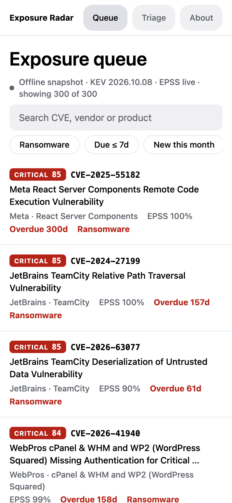
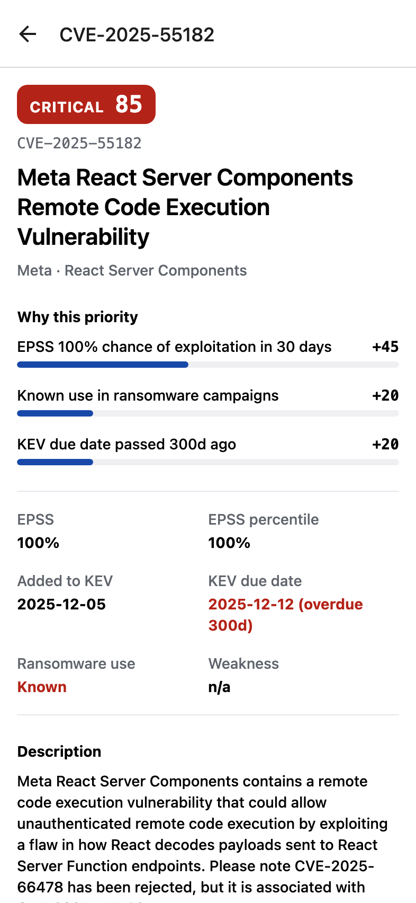
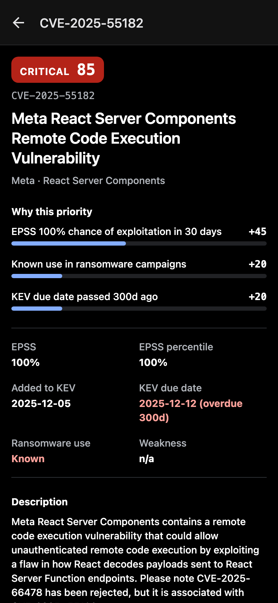

# Exposure Radar

**A React Native (Expo) app built end-to-end with Claude Code, with the AI workflow checked in.**

The app ranks the vulnerabilities attackers are _known_ to exploit (CISA KEV), adds the
probability of exploitation (FIRST EPSS), and turns them into an explainable triage queue.
The repo shows how it was built: the context files, skills, subagents, hooks and
permissions the agent worked with, and an honest log of the session.

**[Live web demo](https://matiaskochlowski.github.io/exposure-radar/)** · [How it's built with Claude Code](docs/AI_WORKFLOW.md) · [Dev log](DEV_LOG.md)

<p>
  
  
  
</p>

---

## What the app does

- **Queue:** all KEV entries, ordered by a 0–100 priority score. Search by CVE, vendor or
  product. Filter by ransomware use, due within 7 days, or added this month.
- **Explainable score:** every score is a sum of named reasons (EPSS, ransomware use,
  overdue, new). The detail screen shows each one, and the About screen renders the model
  from the same constant the code uses ([ADR 0002](docs/adr/0002-explainable-priority-score.md)).
- **Triage:** mark exposures _Investigating_, _Mitigated_ or _Risk accepted_ and add notes.
  This is stored on the device only.
- **Offline-first:** a bundled snapshot of KEV + EPSS keeps the app (and the GitHub Pages
  demo) working without a backend ([ADR 0004](docs/adr/0004-bundled-snapshot-fallback.md)).
- **Untrusted data handled as such:** feeds are validated at runtime, text is never rendered
  as HTML, and only `https:` links from the feed survive ([SECURITY](docs/SECURITY.md)).

## The AI-driven part

| Layer              | In this repo                                                                                                                                                              |
| ------------------ | ------------------------------------------------------------------------------------------------------------------------------------------------------------------------- |
| **Context**        | [`CLAUDE.md`](CLAUDE.md) → [`AGENTS.md`](AGENTS.md) → [`docs/`](docs): architecture, conventions, testing, security, glossary, [ADRs](docs/adr)                           |
| **Skills**         | [`.claude/skills/`](.claude/skills): `domain-tdd`, `new-screen`, `a11y-pass`, `untrusted-data-review`, `pr-prep`, `refresh-snapshot`                                      |
| **Subagents**      | [`.claude/agents/`](.claude/agents): `code-reviewer`, `security-reviewer` (read-only), `test-writer`                                                                      |
| **Guardrails**     | [`.claude/settings.json`](.claude/settings.json): permission allow/ask/deny lists, plus hooks that block secrets, auto-format, and run `verify` before the agent may stop |
| **Lint as policy** | [`eslint.config.js`](eslint.config.js) enforces the layering: no React, I/O or `new Date()` in `src/domain`                                                               |
| **Evidence**       | [`DEV_LOG.md`](DEV_LOG.md): what the agent decided, what broke, what tests and a real browser caught, and what was _not_ verified                                         |

The loop: **context → small slice → test first → implement → verify (hooks + CI) →
subagent review → human gate.** Details are in [docs/AI_WORKFLOW.md](docs/AI_WORKFLOW.md).

## Run it

Requires Node 22+.

```bash
npm install
npm start          # then press w (web), i (iOS simulator) or a (Android), or scan with Expo Go
npm run verify     # typecheck + lint + 104 tests
npm run snapshot   # refresh the bundled KEV/EPSS data
```

No API keys or environment variables are needed. Both data sources are public.

## Stack

| Concern      | Choice                                                        |
| ------------ | ------------------------------------------------------------- |
| App          | Expo SDK 57, React Native 0.86, React 19.2, TypeScript 6      |
| Navigation   | Expo Router (`NativeTabs` on native, custom tab bar on web)   |
| Server state | TanStack Query, with snapshot fallback                        |
| Local state  | Zustand + AsyncStorage persistence                            |
| Tests        | jest-expo, React Native Testing Library 14                    |
| CI / demo    | GitHub Actions → `npm run verify` → web export → GitHub Pages |

## Project layout

```
src/
  app/          routes only (queue, triage, about, cve/[id])
  domain/       pure TS: priority model, queue filters, link safety, types (+ tests)
  data/         KEV and EPSS clients and parsers, React Query hooks, bundled snapshot
  store/        triage store (Zustand, persisted)
  components/   presentational components (+ tests)
docs/           architecture, conventions, testing, security, glossary, ADRs, AI workflow
.claude/        skills, subagents, hooks, permissions
```

## Data and attribution

- [CISA Known Exploited Vulnerabilities Catalog](https://www.cisa.gov/known-exploited-vulnerabilities-catalog): US Government work, public domain.
- [FIRST EPSS](https://www.first.org/epss/): Exploit Prediction Scoring System scores, used with attribution.

This is demo software, not a substitute for a vulnerability management program.

## License

MIT. See [LICENSE](LICENSE).
